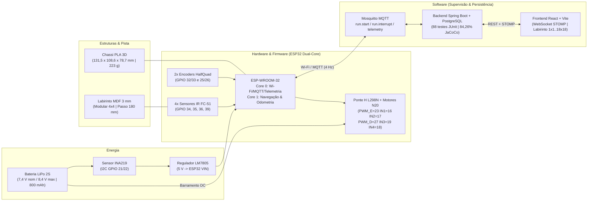
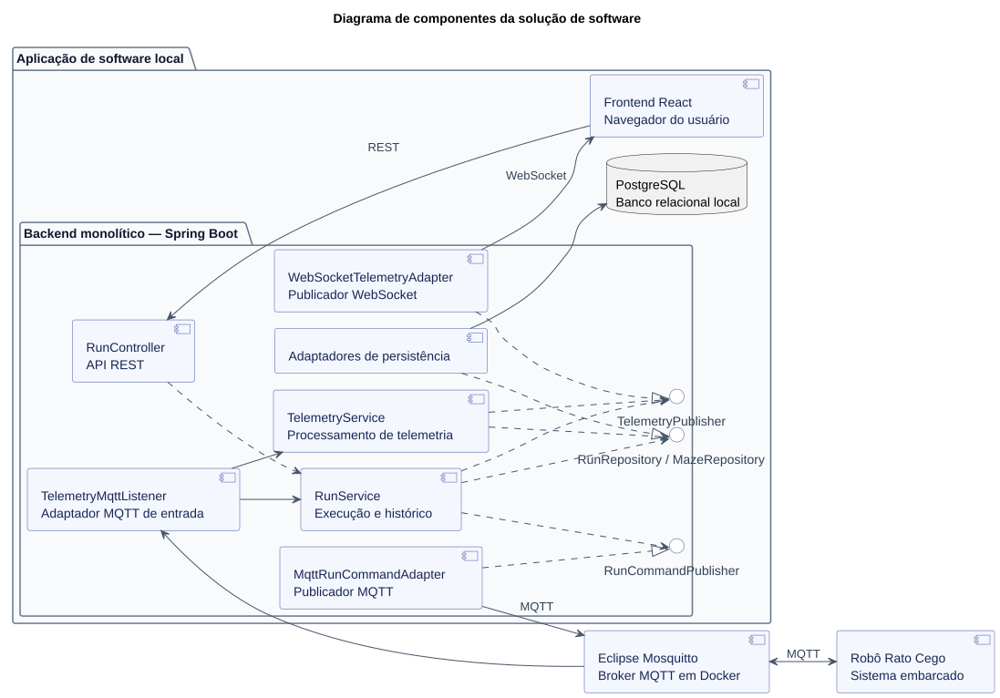

# Testes de Integração – Sistema Completo (Rato Cego)

Este documento consolida os **testes de integração multidisciplinares** do robô autônomo *Micromouse* (**Rato Cego**), desenvolvido na disciplina de Projeto Integrador 1 (PI1), integrando as frentes de **Estruturas**, **Hardware**, **Energia** e **Software** (Firmware ESP32, Broker MQTT, Backend Spring Boot/PostgreSQL e Frontend React).

Enquanto os documentos setoriais ([Testes de estrutura.md](Testes%20de%20estrutura.md), [Testes de hardware.md](Testes%20de%20hardware.md), [Testes de energia.md](Testes%20de%20energia.md) e [Testes de software.md](Testes%20de%20software.md)) validam cada módulo isoladamente ou em bancada simulada, este relatório documenta a **integração física, elétrica, lógica e funcional em ambiente real**, preservando integralmente os registros originais de validação de hardware em bancada/labirinto e adicionando as evidências consolidadas de engenharia até a etapa final de execução integrada.

---

## 1. Visão Geral e Arquitetura Integrada

A integração de ponta a ponta (*end-to-end*) conecta o chassi impresso em 3D, o sistema de alimentação em bateria LiPo 2S, o conjunto sensores/atuadores no microcontrolador ESP-WROOM-32 e a plataforma de supervisão em tempo real.

### Principais Interfaces entre Sub-equipes

| Interface | Sub-equipes Envolvidas | Especificação Integrada |
|---|---|---|
| Fixação chassi × placa × motores × bateria | Estruturas × Hardware × Energia | Acomodação em dois pavimentos no chassi PLA (`223 g`), furação para placa perfurada, abraçadeiras para motores N20 e passagem interna de chicotes. |
| Alimentação de potência e lógica | Energia × Hardware | LiPo 2S (`800 mAh`) alimentando L298N no barramento bruto e ESP32 via `LM7805` (`5 V` em `VIN`) com capacitores de desacoplamento (`0,47 µF`, `100 nF`, `1000 µF`). |
| Leitura de sensores, encoders e atuação PWM | Hardware × Software (Firmware) | ESP32 Core v3.x (`ledcAttach`/`ledcWrite` 20 kHz, 8 bits), encoders em modo `HalfQuad`, IR nos pinos `GPIO 34, 35, 36, 39` e INA219 em `GPIO 21/22` (`100 kHz`). |
| Telemetria, controle de execução e visualização | Software (Firmware × Backend × Frontend) | Comandos `run.start` / `run.interrupt` e telemetria JSON via MQTT/Mosquitto, persistência PostgreSQL e renderização via STOMP no frontend. |

---

## 2. Integração Mecânica e Estrutural

A sub-equipe de Estruturas projetou e fabricou o chassi do robô em impressão 3D (PLA) e o módulo físico de testes do labirinto em MDF `3 mm` cortado em CNC, atendendo à restrição dimensional de corredor do requisito **RNF1** (`< 16,5 × 16,5 cm`).

### Parâmetros Físicos Consolidados

- **Chassi montado (`Testes de estrutura.md`):** `131,5 mm` (comprimento) × `108,6 mm` (largura) × `78,7 mm` (altura), massa total de **`223 g`** com componentes.
- **Geometria conceitual e estabilidade (`Projeto conceitual de estruturas.md`):** placa superior de `83,84 × 74,02 × 10 mm`, compartimento inferior com paredes de `5 mm` para bateria e motores, apoio em triângulo equilátero com roda boba (*caster wheel*) e pneus com aro de borracha para maior aderência.
- **Adaptações em campo durante a integração:**
  - Desbaste/chanfro nos cantos frontais do chassi para evitar colisão em curvas de 90° dentro do corredor;
  - Execução de furos adicionais na base superior para fixação mecânica da placa perfurada de controle;
  - Passagem dedicada de cabos entre o pavimento inferior (bateria/motores) e o superior (ESP32/regulador/sensores) e fixação dos motores com abraçadeiras plásticas (*zip-ties*).
- **Labirinto físico de integração (`4×4`):** módulos em MDF `3 mm`, passo entre centros de células de **`180 mm`** (corredor interno de `168 mm`, paredes de `12 mm` de espessura e `50 mm` de altura), dimensão externa montada aproximada de `732 × 732 mm`.

> [!NOTE]
> **Diferença dimensional documentada entre pista física e modelo lógico:** O módulo de teste em MDF utiliza passo nominal de **`180 mm`** (`18 × 18 cm`), enquanto a parametrização lógica de odometria e requisitos do labirinto (`odometria.cpp` e interface web) adota célula padrão de **`165 mm`** (`16,5 × 16,5 cm`, grade configurável até `18 × 18`). Esse desvio geométrico de `15 mm/célula` foi compensado em firmware durante a calibração de escala de encoders descrita na Seção 5.

| Vista CAD / Montagem Geral | Protótipo Real – Vista 1 | Protótipo Real – Vista 2 | Labirinto Modular Real (4×4) |
|:---:|:---:|:---:|:---:|
|  |  |  |  |

---

## 3. Testes de Integração de Hardware (Bancada e Locomoção)

Esta seção preserva integralmente os ensaios de validação de hardware em bancada e no labirinto conduzidos pela sub-equipe de Hardware (com os respectivos vídeos comprobatórios), registrando adicionalmente a evolução da ponte H entre o projeto conceitual e o protótipo físico final.

> [!IMPORTANT]
> **Evolução do driver de potência na integração final:** Embora o esquemático inicial em [Projeto conceitual de hardware.md](Projeto%20conceitual%20de%20hardware.md) e [Testes de hardware.md](Testes%20de%20hardware.md) previsse a ponte H `MX1508`, a placa física integrada no protótipo final utiliza o driver **`L298N`** (pinagem consolidada em `motores.h`: `PWM_E = 23`, `IN1 = 16`, `IN2 = 17`, `PWM_D = 27`, `IN3 = 19`, `IN4 = 18`) associado ao regulador linear `LM7805` alimentando o pino `VIN` do ESP32.

# Testes de Integração – Hardware
O presente documento tem como objetivo apresentar e documentar o desenvolvimento e a validação da parte de hardware do robô Micromouse (Rato Cego), desenvolvido no âmbito da disciplina de Projeto Integrador 1 (PI1). Serão abordados os procedimentos de testes realizados durante o processo de desenvolvimento, visando verificar o funcionamento individual dos componentes e, principalmente, a integração entre os diferentes sistemas que compõem o robô.

Ao longo deste documento, serão apresentados os testes relacionados aos sensores, motores, encoders, circuitos de alimentação e amostragem da tensão do barramento, além dos ensaios de locomoção e movimentação do robô. Esses testes têm como finalidade avaliar o comportamento dos componentes em condições reais de operação, identificar possíveis falhas e inconsistências e garantir que os sistemas estejam funcionando conforme o esperado.

Além da verificação individual dos componentes, os testes de integração buscam assegurar a comunicação e o funcionamento conjunto entre os módulos de hardware, permitindo analisar a resposta do robô aos comandos recebidos e a confiabilidade das informações coletadas pelos sensores e demais dispositivos.

Dessa forma, esta etapa representa uma parte fundamental do desenvolvimento do projeto, uma vez que permite validar as soluções implementadas, realizar os ajustes necessários e minimizar possíveis problemas durante as etapas posteriores de operação e navegação autônoma do Micromouse. O objetivo final é garantir uma plataforma de hardware funcional, estável e confiável, capaz de atender aos requisitos estabelecidos para o funcionamento do robô.

## Testes de Bateria
A seguir, é apresentado o teste de monitoramento da tensão da bateria do robô, realizado por meio do módulo INA219. Durante o ensaio, os valores medidos pelo sensor foram enviados e exibidos no Monitor Serial da Arduino IDE, permitindo acompanhar as leituras em tempo real e verificar o funcionamento do sistema de aquisição e monitoramento da tensão de alimentação.

https://github.com/user-attachments/assets/f4f2afd3-7a65-4fcf-b789-e954044bd3dd

## Testes dos Motores

A seguir, foram realizados os testes individuais de ambos os motores responsáveis pela locomoção do robô Micromouse, com o objetivo de verificar seu funcionamento, sentido de rotação e resposta aos comandos enviados pelo sistema de controle. Durante os ensaios, foram avaliados os acionamentos dos motores em ambos os sentidos, permitindo identificar possíveis inconsistências no funcionamento e garantir que os dois conjuntos apresentassem respostas adequadas aos comandos estabelecidos.

Além disso, os testes permitiram verificar a integração entre os motores e o circuito responsável pelo seu acionamento, assegurando que os sinais de controle fossem interpretados corretamente e convertidos em movimento mecânico. Essa etapa foi fundamental para validar o sistema de tração do robô, uma vez que o funcionamento adequado e sincronizado dos dois motores é indispensável para a realização de movimentos em linha reta, curvas e manobras necessárias durante a navegação pelo labirinto.

### Motor esquerdo

https://github.com/user-attachments/assets/59ea0dba-5a4f-4c8d-9f4a-cfe503aacd4d

### Motor direito

https://github.com/user-attachments/assets/75047bc2-062f-4108-b39a-5d49f1da4bf1

## Testes dos Encoders

A seguir, são apresentados os testes realizados nos encoders acoplados aos motores do robô Micromouse. O procedimento consiste em realizar a rotação do eixo de cada motor por meio de um código desenvolvido e executado na Arduino IDE, permitindo monitorar e contabilizar os pulsos gerados pelos encoders durante o movimento.

O objetivo desse ensaio é determinar a quantidade de pulsos gerados a cada volta completa do eixo do motor, possibilitando caracterizar o comportamento dos encoders e verificar a consistência das leituras obtidas. As informações coletadas são fundamentais para o desenvolvimento do sistema de controle de movimento, uma vez que permitem estimar a rotação dos motores, acompanhar o deslocamento das rodas e fornecer dados para o controle de velocidade e posicionamento do robô.

Dessa forma, os testes permitem validar o funcionamento dos encoders e garantir que os sinais de realimentação sejam corretamente interpretados pelo microcontrolador, contribuindo para uma locomoção mais precisa e controlada durante a navegação do Micromouse.

### Encoder esquerdo

https://github.com/user-attachments/assets/de1ecd0c-4f3b-4ad0-9075-72a6d38e37d7

### Encoder direito

https://github.com/user-attachments/assets/9eab6e16-1f8a-4859-a0e0-7390c647fcf0

## Testes dos Sensores

A seguir, são apresentados os testes realizados nos sensores de proximidade do robô Micromouse. Para a realização do ensaio, foi desenvolvido um código na Arduino IDE responsável por realizar a leitura dos valores analógicos dos sensores e transmiti-los ao Monitor Serial, permitindo acompanhar as variações dos sinais em tempo real.

Durante o procedimento, as mãos foram aproximadas individualmente da região frontal de detecção dos sensores, simulando a presença de paredes e obstáculos no labirinto. Com essa aproximação, foram observadas as variações nos valores de conversão analógico-digital (ADC), exibidos diretamente no Monitor Serial da Arduino IDE.

O objetivo desse teste foi verificar a capacidade de detecção dos sensores, analisar suas respostas diante da aproximação de obstáculos e confirmar o funcionamento do processo de aquisição e transmissão dos dados ao microcontrolador. Essas informações são essenciais para o sistema de navegação do Micromouse, pois permitem identificar as paredes do labirinto e auxiliar na tomada de decisões durante sua movimentação autônoma.

https://github.com/user-attachments/assets/e10c2ab9-da3a-4600-b064-3b85f6d6397a

## Testes de Locomoção no Labirinto

Por fim, foram realizados os testes de integração do robô Micromouse em um ambiente que simula o labirinto, com o objetivo de avaliar o funcionamento conjunto dos sistemas de hardware durante a locomoção. Nessa etapa, o robô foi colocado diretamente no labirinto para verificar seu comportamento diante dos obstáculos e sua capacidade de realizar os movimentos necessários para percorrer os corredores.

Durante os ensaios, foram avaliados o acionamento e a sincronização dos motores, a resposta dos sensores de proximidade na identificação das paredes e a utilização dos encoders para o acompanhamento da rotação dos motores e do deslocamento das rodas. Dessa maneira, foi possível observar a interação entre os diferentes componentes e verificar se os sinais captados pelos sensores e encoders correspondiam adequadamente às condições de movimentação do robô.

Esse teste representa uma das etapas mais importantes da validação do hardware, pois permite avaliar o desempenho dos componentes não apenas individualmente, mas também em conjunto, considerando as condições reais de operação do projeto. Além disso, possibilita identificar eventuais dificuldades relacionadas à locomoção, ao alinhamento, à detecção de obstáculos e à execução de manobras, fornecendo informações importantes para a realização de ajustes e melhorias.

Assim, os testes no labirinto permitem verificar se a estrutura de hardware desenvolvida atende às necessidades de movimentação e navegação do Micromouse, contribuindo para a validação final do sistema e para o desenvolvimento das próximas etapas do projeto.

https://github.com/user-attachments/assets/cf46bdfd-20cd-4ac6-9191-b18ea2abefbe

---

## 4. Integração Elétrica e Monitoramento de Energia

A sub-equipe de Energia dimensionou a arquitetura de potência para suportar 30 minutos de operação contínua sem ultrapassar 80% da capacidade nominal da célula, evitando degradação por descarga profunda.

### Métricas Energéticas de Projeto e Validação

| Parâmetro | Referência de Projeto | Resultado Medido / Simulado | Status |
|---|---|---|---|
| Bateria selecionada | LiPo 2S (`7,4 V` nominal / `8,4 V` cheia / `800 mAh` / `5,92 Wh`) | Integrada ao barramento físico do robô | Validado |
| Limite de descarga segura (80%) | `640 mAh` (`4,736 Wh` úteis) | Consumo estimado com margem de 20%: `2,599 Wh` (`2,16565 Wh` nominais / `7796,34 J`) | Validado |
| Ensaio de 30 min (`Testes de energia.md`) | `181` amostras (intervalo de `10 s`) | Corrente média **`937,3 mA`**, consumo acumulado **`468,7 mAh` (`58,6%` de `800 mAh`)** | Aprovado |
| Regulação lógica e proteção contra ruído | `LM7805` (`8,4 V → 5 V`) + capacitores `0,47 µF`, `100 nF`, `1000 µF` | Estável com bateria carregada; reinicialização (*brownout*) observada com bateria severamente descarregada | Condicional à carga |
| Limiar de bateria fraca no Backend | Histerese de alerta `6,6 V` / `6,8 V` | Alerta funcional no fluxo MQTT → Backend → Frontend | Validado |

### Diagnóstico de Falhas na Integração Elétrica Real

1. **Barramento I²C do INA219 na placa soldada:** Apesar de o módulo `INA219` (`GPIO 21/22`, `100 kHz`) ter operado corretamente em bancada na Arduino IDE (vídeo da Seção 3), durante a integração na placa definitiva montada no chassi o barramento I²C não retornou *ACK* ao ESP32. Para não bloquear a telemetria do sistema supervisório, o firmware implementa *fallback* com estimativa dinâmica de tensão/corrente da LiPo 2S, mantendo pendente a inspeção de solda/trilha do `INA219`.
2. **Brownout sob descarga avançada da bateria (Corrida `#75`):** Durante ensaios consecutivos sem recarga externa (`#1` a `#79`), observou-se na **Corrida `#75`** queda acentuada da tensão de barramento sob corrente de pico na manobra de curva (`PWM = 120`, velocidade reduzida para `0,09–0,11 m/s`), fazendo a saída do `LM7805` cair abaixo do limite mínimo de operação do ESP32 e reiniciando o microcontrolador após publicar o início de movimento.

---

## 5. Integração Software × Firmware × Hardware (Sistema Fim a Fim)

A camada de software combina firmware embarcado FreeRTOS no ESP32 (`src/firmware/`), broker Mosquitto MQTT, backend Java/Spring Boot com PostgreSQL e frontend React/Vite via REST e WebSocket STOMP.

### Verificação Automatizada e Simulada de Software (`Testes de software.md`)

- **Suíte Backend (`./mvnw verify`):** **88 testes JUnit/Mockito** executados em **21 classes** com resultado `BUILD SUCCESS`.
- **Cobertura JaCoCo:** **84,26%** de cobertura de linhas (`514/610`), **85,97%** de instruções, **70,86%** de ramos (*branches*), **89,66%** de métodos e **91,84%** de classes.
- **Casos de Teste Simulados (`CT-04` a `CT-13`):** Validação completa do ciclo de vida da execução, detecção de paredes, mapeamento incremental e histerese de bateria baixa com simulador Python antes dos testes com o protótipo físico.

| Monitoramento em Execução | Execução Interrompida | Detalhe da Execução |
|:---:|:---:|:---:|
|  |  |  |

### Integração Real com o Protótipo Físico (`Corridas #1` a `#79`)

Durante a transição do simulador Python para o robô real no labirinto de MDF `4×4`, os testes práticos evidenciaram ajustes críticos que foram implementados e validados no código:

1. **Sincronismo MQTT/STOMP e Resiliência de Sessão (`run.start` / `run.interrupt`):**
   - Ajustes em `MqttTelemetryListener`, `RunLifecycleService` e `App.tsx` para suportar grades configuráveis de `1×1` até `18×18`, seleção explícita da célula inicial (`bottom_left` ou `bottom_right`), prevenção de execuções órfãs e reconexão limpa entre frontend, backend e ESP32.
   - **Taxa de telemetria:** O firmware publica em **`4 Hz`** (`TELEMETRY_INTERVAL_MS = 250 ms`), complementado por envio imediato sempre que `poseAlterada` sinaliza transição de célula ou rotação, enquanto o requisito **RNF38** especifica **`10 Hz`** (`100 ms`).
2. **Calibração de Odometria (`HalfQuad` × Labirinto Físico):**
   - Os encoders operam em modo **`HalfQuad` (`2x`)**, exigindo recalibração de `PASSO_CELULA_ENC_MM = 72` com fator de escala `ESCALA_DISTANCIA_REAL = 165.0f / 72.0f` e `AVANCO_SAIDA_CURVA_ENC_MM = 76`.
   - Implementação de `odometriaConcluirTrechoReto()` no encerramento de segmentos retos para eliminar subcontagem acumulada ao cruzar fronteiras de célula.
   - Adição de *clamp* em `RE()` (`<= 10` unidades) e autoajuste da orientação inicial (*heading*) na partida a partir das extremidades (`bottom_left` / `bottom_right`).
3. **Correção do Giro sem Ré (`curva(±90, false)`):**
   - Observou-se em pista que, quando o robô executava curva de 90° seguida de ré (`RE()`), a nova célula era reconhecida corretamente no labirinto virtual; porém, quando realizava a curva no próprio eixo **sem ré**, o deslocamento anterior era subestimado e a transição de célula seguinte falhava.
   - Como correção, foi adicionado um deslocamento de pivô de **`30` unidades** na função `curva(±90, false)` (implementado em firmware e pendente de validação física final após recarga da bateria).
4. **Evidência de Rastreamento Real (Corrida `#45`):**
   - Na **Corrida `#45`**, o robô real percorreu o trajeto em zigue-zague no labirinto `4×4`: `(3,3) → (3,0) → (2,0) → (2,3) → (1,3) → (1,0)`, totalizando **`1,97 m`** rastreados de forma consistente entre o deslocamento físico e o labirinto virtual exibido na interface web.

---

# Testes de Integração

Confiram as regras de avaliação dos testes de integração no [documento do tema do projeto](https://docs.google.com/presentation/d/1hRx0g9mpVGQbTv44gLEoAyf4b4kKM4vnrABTnG8HlUk/edit?usp=sharing).

| **ID** | **Descrição** | **Data de Início** | **Data de Conclusão** | **Sub-equipes** | **Responsável** | **Resultados Esperados** | **Resultados Obtidos** | **Aprovação Interna (S/N)** | **Aprovação do Orientador (S/N)** | **Observações** |
|:------:|---------------|--------------------|-----------------------|----------------|-----------------|--------------------------|------------------------|:---------------------------:|:--------------------------------:|-----------------|
| 5.1 | Integração mecânica do chassi PLA com motores N20, placa perfurada, sensores IR e bateria LiPo 2S | 16/10/2026 | 12/11/2026 | Estruturas, Hardware, Energia | Heitor Nobre, Gabriel Cavalcanti, Gabriel Magioli | Conjunto completo montado dentro do limite `RNF1` (`< 16,5 × 16,5 cm`), sem interferência mecânica em curvas | Chassi final com `131,5 × 108,6 × 78,7 mm` (`223 g`), cantos frontais desbastados, furos para placa e passagem de cabos | S | Pendente | Fotos em `figs/estrutura/testes/prototipo_real_1.jpg` e `prototipo_real_2.jpg` |
| 5.2 | Montagem e validação dimensional do labirinto modular MDF 4×4 em CNC | 16/10/2026 | 12/11/2026 | Estruturas | Henrique Brandão, Pedro Augusto Ribeiro | Pista modular rígida com corredores livres para o protótipo e contraste compatível com sensores IR | Labirinto MDF `3 mm` montado (`~732 × 732 mm`, passo `180 mm`, corredor `168 mm`, parede `50 mm`) | S | Pendente | Diferença entre passo físico (`180 mm`) e lógico (`165 mm`) compensada em odometria |
| 5.3 | Integração do circuito de alimentação LiPo 2S + regulador `LM7805` + capacitores de filtro | 05/10/2026 | 15/10/2026 | Energia, Hardware | Rafael Wasconcelos, Maria Laura | Barramento `5 V` estável no `VIN` do ESP32 e alimentação dos motores sem resets por ruído com bateria carregada | Regulação estável em bancada e nos ensaios iniciais; autonomia simulada de `30 min` com `468,7 mAh` (`58,6%` de `800 mAh`) | S | Pendente | Com bateria severamente descarregada ocorreu *brownout* na Corrida `#75` |
| 5.4 | Aquisição da tensão e corrente da bateria pelo módulo `INA219` via I²C (`GPIO 21/22`) | 05/10/2026 | 24/11/2026 | Hardware, Energia, Software | Gabriel Cavalcanti, Pedro Gustavo Nunes, Vinícius Araújo | Leituras reais de tensão/corrente entregues pelo barramento I²C (`100 kHz`) ao ESP32 e enviadas na telemetria | Validado em bancada (vídeo Seção 3); na placa final soldada o I²C não retornou *ACK*, ativando *fallback* dinâmico no firmware | Parcial | Pendente | Pendente inspeção física de solda/trilha do `INA219` |
| 5.5 | Integração do driver de potência (`L298N`) com motores N20 e controle PWM do ESP32 (`ledcAttach`) | 05/10/2026 | 15/10/2026 | Hardware, Software | Gabriel Cavalcanti, Vinícius Araújo, Gustavo Noronha | Acionamento independente frente/ré e controle de velocidade nos dois eixos sem falhas de lógica | Motores esquerdo e direito validados individualmente e sincronizados em `20 kHz` (8 bits) nos vídeos da Seção 3 | S | Pendente | Driver atualizado de `MX1508` (conceitual) para `L298N` no hardware final |
| 5.6 | Integração dos encoders acoplados aos motores com leitura de quadratura (`HalfQuad`) no ESP32 | 05/10/2026 | 18/11/2026 | Hardware, Software | Vinícius Araújo, Pedro Augusto Moretti | Contagem bidirecional consistente de pulsos por volta para cálculo de deslocamento e velocidade | Encoders esquerdo e direito validados (vídeos Seção 3); calibrados em firmware (`PASSO_CELULA_ENC_MM = 72`, `ESCALA = 165/72`) | S | Pendente | Ajuste essencial devido à contagem `2x` do modo `HalfQuad` |
| 5.7 | Integração dos 4 sensores infravermelhos (`FC-51`) nos pinos ADC do ESP32 (`GPIO 34, 35, 36, 39`) | 05/10/2026 | 15/10/2026 | Hardware, Software | Maria Laura, Gustavo Noronha | Detecção confiável de paredes frontais e laterais no labirinto sem saturação por luminosidade | Sensores validados em bancada (vídeo Seção 3) e integrados à detecção de paredes em tempo real nas corridas | S | Pendente | Calibração de limiar mantida conforme ambiente interno do labirinto MDF |
| 5.8 | Integração da arquitetura FreeRTOS dual-core no firmware (Core 0 comunicação / Core 1 navegação) | 20/10/2026 | 20/11/2026 | Software (Firmware) | Vinícius Araújo, Thiago Alencar | Execução paralela do loop de controle/odometria sem bloqueios por Wi-Fi/MQTT | Arquitetura dual-core estável; publicação periódica a `4 Hz` (`250 ms`) + envio imediato em `poseAlterada` | Parcial | Pendente | `RNF38` prevê `10 Hz`; taxa mantida em `4 Hz` para estabilidade do broker |
| 5.9 | Integração Firmware × Broker Mosquitto × Backend Spring Boot × PostgreSQL (comandos e telemetria) | 20/10/2026 | 23/11/2026 | Software | Laryssa, Letícia, Maria Eduarda, Thiago Alencar | Recebimento de `run.start`/`run.interrupt`, ingestão de telemetria MQTT e persistência das corridas e células | Fluxo fim a fim validado em 88 testes JUnit (`BUILD SUCCESS`, `84,26%` linhas JaCoCo) e em 79 corridas registradas | S | Pendente | Correções aplicadas em `MqttTelemetryListener` e `RunLifecycleService` |
| 5.10 | Integração Backend × Frontend React/Vite via REST e WebSocket STOMP (mapa dinâmico e estado da bateria) | 25/10/2026 | 23/11/2026 | Software | Laryssa, Letícia, Maria Eduarda | Atualização em tempo real do labirinto (`1×1..18×18`), posição inicial (`bottom_left`/`bottom_right`) e alertas | Renderização em tempo real validada (figuras em `figs/testes_software/`) e sincronizada com o robô físico até a Corrida `#45` | S | Pendente | Histerese de alerta de bateria (`6,6 V` / `6,8 V`) validada |
| 5.11 | Alerta e interrupção segura por bateria baixa na cadeia Energia × Firmware × Backend × Frontend | 10/11/2026 | 24/11/2026 | Energia, Hardware, Software | Pedro Gustavo Nunes, Thiago Alencar, Letícia | Detecção de tensão crítica antes do colapso do regulador, permitindo parada controlada e aviso visual | Alerta de software validado; na prática física (`Corrida #75`) a bateria exaurida causou *brownout* no `LM7805` antes da parada | Parcial | Pendente | Necessário recarregar LiPo 2S e restaurar leitura real do `INA219` |
| 5.12 | Calibração de odometria e navegação em linha reta no labirinto MDF 4×4 | 12/11/2026 | 23/11/2026 | Hardware, Software, Estruturas | Vinícius Araújo, Gabriel Cavalcanti, Yasmim Santos | Avanço de múltiplas células consecutivas sem perda de sincronismo com a grade virtual | `odometriaConcluirTrechoReto()` e `AVANCO_SAIDA_CURVA_ENC_MM = 76` eliminaram subcontagem; Corrida `#45` percorreu `1,97 m` em zigue-zague | S | Pendente | Trajeto `(3,3)→(3,0)→(2,0)→(2,3)→(1,3)→(1,0)` validado |
| 5.13 | Validação de curvas de 90° (com ré e pivô no próprio eixo) e reconhecimento da célula subsequente | 18/11/2026 | 24/11/2026 | Software (Firmware), Hardware | Vinícius Araújo, Gabriel Cavalcanti | Reconhecimento imediato da nova célula após curva de 90° em qualquer extremidade ou corredor, com ou sem ré | Curva com `RE()` validada em pista; ajuste de `30` unidades em `curva(±90, false)` e `clamp <= 10` em `RE()` implementado em código | Parcial | Pendente | Aguarda teste físico na pista após recarga da bateria |
| 5.14 | Execução de percurso completo autônomo no labirinto 4×4 com mapeamento fim a fim | 18/11/2026 | 24/11/2026 | Estruturas, Hardware, Energia, Software | Toda a equipe | Exploração autônoma completa do módulo 4×4 com registro contínuo das paredes e chegada à área alvo | Parcialmente validado na Corrida `#45` (`6` segmentos / `1,97 m`); interrompido nas tentativas finais por descarga da bateria (`#75`) | Parcial | Pendente | Retomar ensaios após recarga completa da LiPo 2S |
| 5.15 | Teste de escalabilidade integrada em bancada/simulador para grades maiores (`8×4` e `12×4`) | 20/11/2026 | 24/11/2026 | Software, Estruturas | Pedro Augusto Moretti, Pedro Calcado | Suporte lógico e estabilidade de telemetria/odometria em matrizes intermediárias antes da pista completa | Grade configurável até `18×18` e simulador validados em software; execução com robô físico ainda não realizada | N | Pendente | Programado após validação final em `4×4` e recarga da bateria |
| 5.16 | Validação integrada final com o orientador e consolidação dos artefatos de entrega | 23/11/2026 | 04/12/2026 | Todas as sub-equipes | Bruno Luiz Pereira (Orientador) + Líderes | Demonstração presencial de todo o sistema integrado e aprovação formal dos testes de integração | Documentação técnica consolidada na branch `docs/testes-integracao` para revisão prévia | N | Pendente | Execução presencial prevista após conclusão dos itens `5.4`, `5.13` e `5.14` |

---

## 7. Não Conformidades Conhecidas, Lições Aprendidas e Próximos Passos

Durante a realização das corridas integradas (`#1` a `#79`) e a revisão cruzada entre documentos, foram registradas as seguintes pendências técnicas abertas para fechamento antes da banca/avaliação final:

1. **Recarga da bateria LiPo 2S e novo ensaio de locomoção/manobras:** A bateria encontra-se descarregada após a sequência até a **Corrida `#75`** (causando queda de tensão no `LM7805` e reinicialização do ESP32 em curvas). Assim que recarregada, devem ser executados os testes de pista para o deslocamento de pivô (`30` unidades) em `curva(±90, false)` e a confirmação completa em `4×4`.
2. **Diagnóstico físico do sensor `INA219` (I²C):** Verificar continuidade e soldas nos pinos `SDA` (`GPIO 21`) e `SCL` (`GPIO 22`) da placa montada no robô para restabelecer o *ACK* real de tensão e corrente e desativar o *fallback* por estimativa.
3. **Expansão de ensaios físicos para `8×4` e `12×4`:** Após estabilizar a bateria e a curva sem ré no módulo `4×4`, ampliar a pista modular e validar a odometria acumulada em trajetos médios e longos.
4. **Conformidade da taxa de telemetria (`4 Hz` vs. `10 Hz` do `RNF38`):** Avaliar a redução de `TELEMETRY_INTERVAL_MS` de `250 ms` (`4 Hz`) para `100 ms` (`10 Hz`) em ensaio de carga com Wi-Fi e Mosquitto reais, garantindo ausência de *backlog* no ESP32 e no cliente web.

---

## 8. Histórico de Versões

| Versão | Data | Autor(es) | Descrição |
|---|---|---|---|
| 1.0 | 18/11/2026 | Gabriel Cavalcanti (`CavalcantiG`) | Registro inicial dos testes de integração de hardware em bancada/labirinto (bateria, motores, encoders, sensores IR e locomoção com vídeos) e criação da tabela base `5.1`–`5.16`. |
| 2.0 | 24/11/2026 | Equipe Integrada (Estruturas, Hardware, Energia, Software) | Consolidação multidisciplinar completa: arquitetura integrada, parâmetros estruturais (`223 g`, `131,5 × 108,6 × 78,7 mm`, labirinto `180 mm`), nota de evolução `MX1508 → L298N`, métricas energéticas (`937,3 mA` / `468,7 mAh`), evidências de software (`88` testes / `84,26%` JaCoCo), diagnóstico das corridas `#1`–`#79` (`#45` e `#75`), matriz `5.1`–`5.16` preenchida e plano de encerramento das pendências. |
